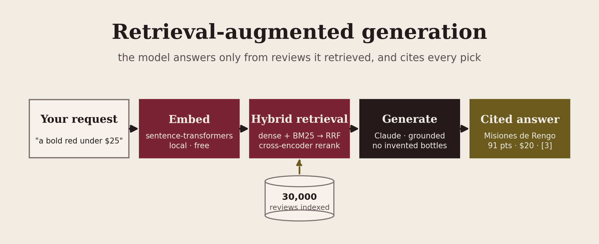

# Wine Sommelier RAG

A retrieval-augmented wine recommender: ask in plain English and get two or three real bottles, each cited to a Wine Enthusiast review.

[Live site](https://lyhjeremy.github.io/wine-sommelier-rag/) · [Write-up](https://lyhjeremy.github.io/wine-sommelier-rag/overview/) · [Technical notes](writeup.md)

Design and copy follow [these standards](https://github.com/lyhjeremy/lyhjeremy/blob/main/DESIGN_STANDARDS.md).

## Results

`src/eval.py` compares three retrievers on 12 rubric-labelled queries:

| Retriever | P@10 | MRR | nDCG@10 |
|---|---|---|---|
| Dense (vector only) | 0.68 | 0.88 | 0.69 |
| Dense + BM25 (Reciprocal Rank Fusion) | 0.67 | 0.76 | 0.68 |
| Dense + BM25 + cross-encoder rerank | **0.82** | **0.92** | **0.83** |

- The cross-encoder reranker raised precision and nDCG@10 about 21% over the dense baseline.
- Fusing BM25 in without a reranker lowered MRR from 0.88 to 0.76: keyword matches pulled in reviews of the wrong kind of wine.
- Retrieval runs locally at no cost. Only generation calls Claude.



## Method

1. **Documents.** `src/ingest.py` de-duplicates the reviews on title and description, keeps the 30,000 highest-scored by default (`--all` indexes all of them), and turns each into a short passage with score, price, country and grape kept as metadata.
2. **Dense retrieval.** `all-MiniLM-L6-v2` (sentence-transformers, 384 dimensions) embeds each passage on MPS, CUDA or CPU. Chroma stores the vectors with cosine similarity. Price, country, grape and minimum-score filters go into the vector query.
3. **Sparse retrieval and fusion.** A BM25 index (`rank-bm25`) ranks the same corpus, and Reciprocal Rank Fusion merges the two rankings.
4. **Reranking.** The cross-encoder `ms-marco-MiniLM-L-6-v2` reads the query and each candidate together and re-orders the fused shortlist (60 candidates by default, 80 in the benchmark).
5. **Grounded generation.** Claude receives the top reviews with a system prompt that allows recommendations only from them, each cited by `[n]`, and tells it to say so when nothing fits.
6. **Evaluation.** Each of the 12 queries has a rubric (wine family or grape, country, price cap, descriptor keywords). A review is relevant if it meets the rubric. The harness reports P@10, Recall@10, MRR and nDCG@10 and writes `eval/results.csv` and `eval/retrieval_quality.png`.

Stack: Python, pandas, sentence-transformers, Chroma, rank-bm25, Claude (CLI by default, Anthropic API optional), matplotlib.

## How to run

```bash
pip install -r requirements.txt

python fetch_data.py                 # download the ~130k-review dataset to data/
python -m src.ingest --limit 30000   # build the local index (or --all)

python -m src.cli ask "a bold red under $25 for a steak dinner" --max-price 25
python -m src.cli chat               # interactive session
python -m src.eval                   # rerun the retrieval benchmark
```

`--no-hybrid` (dense only) and `--no-rerank` (skip the cross-encoder) compare retrieval modes on any query. Filters compose with the request:

```bash
python -m src.cli ask "elegant and mineral, great with oysters" \
    --country France --max-price 40 --min-points 90
```

Generation uses the Claude CLI and your Claude subscription by default. Set `ANTHROPIC_API_KEY` to use the API instead.

## Repo layout

| File | What it is |
|---|---|
| `fetch_data.py` | Downloads the Wine Enthusiast 130k-review dataset |
| `src/ingest.py` | Reviews to documents to local embeddings to Chroma |
| `src/embedder.py` | Local sentence-transformers embedder |
| `src/retriever.py` | Dense vector search with metadata filters (the baseline) |
| `src/hybrid.py` | Dense + BM25, RRF fusion, cross-encoder reranking |
| `src/eval.py` | Retrieval benchmark (P@k, Recall@k, MRR, nDCG@k) |
| `src/sommelier.py` | The RAG chain: retrieve, then a grounded, cited recommendation |
| `src/llm.py` | LLM wrapper: Claude CLI (default) or Anthropic API |
| `src/cli.py` | `ask` (one-shot) and `chat` (interactive) commands |
| `assets/make_architecture.py` | Draws `assets/architecture.png` |

## Limitations

- Twelve queries with rule-based relevance is a fair comparison between retrievers, not an absolute quality score. A small hand-labelled set would make the absolute numbers more trustworthy.
- Recall@10 is about 0.03 for every system because most rubrics match hundreds of reviews.
- All reviews come from one magazine and share its coverage gaps.
- Constraints such as price are set with CLI flags; the system does not parse "under twenty bucks" from the sentence.

The repo ships code only. The dataset and index are built locally and git-ignored.

## License

[MIT](LICENSE) © 2026 Jeremy Lee
