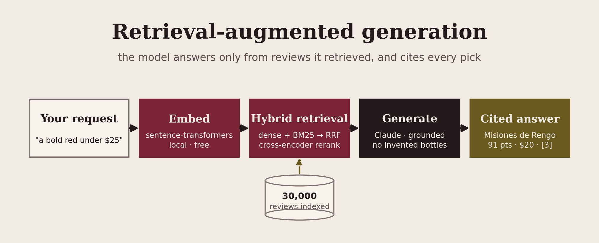

# Wine Sommelier RAG

A retrieval-augmented wine recommender: ask in plain English and get two or three bottles, each cited to a Wine Enthusiast review, with no invented bottles, scores or prices.

Result: against dense retrieval alone, hybrid retrieval plus a cross-encoder reranker lifted nDCG@10 from 0.67 to 0.83 on the original 12 queries and from 0.59 to 0.76 on 30 queries frozen before their first run; retrieval takes 196 ms median on an Apple M4 and a Claude CLI answer 8.3 s and about $0.13 API-equivalent.

[Live site](https://lyhjeremy.github.io/wine-sommelier-rag/) · [Write-up](https://lyhjeremy.github.io/wine-sommelier-rag/overview/) · [Technical notes](writeup.md)

Design and copy follow [these standards](https://github.com/lyhjeremy/lyhjeremy/blob/main/DESIGN_STANDARDS.md).

## Results

`src/eval.py` compares three retrievers on 12 rubric-labeled queries. `eval/run_eval.py` reruns them per query and adds 30 held-out queries from `eval/queries_v2.json`, committed before the first run:

| Retriever | P@10 | MRR | nDCG@10 |
|---|---|---|---|
| Dense (vector only) | 0.68 | 0.82 | 0.67 |
| Dense + BM25 (Reciprocal Rank Fusion) | 0.67 | 0.77 | 0.68 |
| Dense + BM25 + cross-encoder rerank | **0.82** | **0.92** | **0.83** |
| *30 held-out queries:* | | | |
| Dense (vector only) | 0.58 | 0.73 | 0.59 |
| Dense + BM25 (Reciprocal Rank Fusion) | 0.66 | 0.82 | 0.68 |
| Dense + BM25 + cross-encoder rerank | **0.75** | **0.87** | **0.76** |

- The cross-encoder reranker raised P@10 21% and nDCG@10 24% over the dense baseline.
- Fusing BM25 in without a reranker lowered MRR from 0.82 to 0.77 on the 12 style-led queries, but raised it from 0.73 to 0.82 on the 30 new ones, which name more grapes and places. The reranker helped on both sets (nDCG@10 gain +0.16 on the 30, 95% bootstrap interval 0.06 to 0.27).
- Reproducibility: these numbers use exact dense search in `src/eval.py`, so any rebuild of the index gives the same values. The app searches Chroma's approximate HNSW index, whose graph differs on every build; over 20 rebuilds from the same embeddings (`eval/rebuild_spread.csv`, chromadb 1.5.9) dense MRR on the 12 queries ranged 0.82 to 0.88 and hybrid nDCG@10 0.67 to 0.69, while the reranked rows moved by at most 0.0003. Earlier versions of this README reported one such build (dense MRR 0.88, nDCG@10 0.69).
- Error analysis (`eval/error_analysis.json`): of 300 reranked top-ten slots on the 30-query set, 76 miss the rubric. The two largest groups are the wrong grape or color (20) and a price stated in the sentence that is ignored (19), because price is only a CLI flag. 16 are rubric errors (an Amarone filed as "Red Blend").
- In 20 full runs (`eval/generation_runs.jsonl`) no answer cited a source outside its six, quoted a score not in them, or gave a price that was not a source price, the budget or a difference between the two.
- Latency (`eval/latency_retrieval_summary.json`, Apple M4): retrieval 196 ms median, 257 ms p95 over 126 timings; the reranker is 145 ms of it. Generation through the Claude CLI: 8.3 s median, 11.2 s p95, $0.132 median API-equivalent cost (n = 20, `claude-opus-5-5`, mostly the CLI's own ~28,000-token context).
- Retrieval runs locally at no cost. Only generation calls Claude.



## Method

1. `src/ingest.py` de-duplicates the reviews on title and description, keeps the 30,000 highest-scored by default (`--all` indexes all of them), and turns each into a short passage with score, price, country and grape kept as metadata.
2. `all-MiniLM-L6-v2` (sentence-transformers, 384 dimensions) embeds each passage on MPS, CUDA or CPU. Chroma stores the vectors with cosine similarity. Price, country, grape and minimum-score filters go into the vector query.
3. A BM25 index (`rank-bm25`) ranks the same corpus, and Reciprocal Rank Fusion merges the two rankings.
4. The cross-encoder `ms-marco-MiniLM-L-6-v2` reads the query and each candidate together and re-orders the fused shortlist (60 candidates by default, 80 in the benchmark).
5. Claude receives the top reviews with a system prompt that allows recommendations only from them, each cited by `[n]`, and tells it to say so when nothing fits.
6. Each of the 12 queries has a rubric (wine family or grape, country, price cap, descriptor keywords). A review is relevant if it meets the rubric. The harness reports P@10, Recall@10, MRR and nDCG@10 and writes `eval/results.csv` and `eval/retrieval_quality.png`.

Stack: Python, pandas, sentence-transformers, Chroma, rank-bm25, Claude (CLI by default, Anthropic API optional), matplotlib. The write-up steps through `eval/results.csv` one metric at a time and has a small calculator for the RRF formula in `src/hybrid.py`, which shows why a review ranked 61st in both lists outscores one ranked first in only one.

## How to run

```bash
python3 -m venv .venv && source .venv/bin/activate
pip install -r requirements.txt

python fetch_data.py                 # download the ~130k-review dataset to data/
python -m src.ingest --limit 30000   # build the local index (or --all)

python -m src.cli ask 'a bold red under $25 for a steak dinner' --max-price 25
python -m src.cli chat               # interactive session
python -m src.eval                   # rerun the retrieval benchmark
```

`--no-hybrid` (dense only) and `--no-rerank` (skip the cross-encoder) compare retrieval modes on any query. Filters compose with the request:

```bash
python -m src.cli ask "elegant and mineral, great with oysters" \
    --country France --max-price 40 --min-points 90
```

Generation uses the Claude CLI and your Claude subscription by default. Set `ANTHROPIC_API_KEY` to use the API instead.

## Repo layout

| File | What it is |
|---|---|
| `fetch_data.py` | Downloads the Wine Enthusiast 130k-review dataset |
| `src/ingest.py` | Reviews to documents to local embeddings to Chroma |
| `src/embedder.py` | Local sentence-transformers embedder |
| `src/retriever.py` | Dense vector search with metadata filters (the baseline) |
| `src/hybrid.py` | Dense + BM25, RRF fusion, cross-encoder reranking |
| `src/eval.py` | Retrieval benchmark (P@k, Recall@k, MRR, nDCG@k) |
| `src/sommelier.py` | The RAG chain: retrieve, then a grounded, cited recommendation |
| `src/llm.py` | LLM wrapper: Claude CLI (default) or Anthropic API |
| `src/cli.py` | `ask` (one-shot) and `chat` (interactive) commands |
| `assets/make_architecture.py` | Draws `assets/architecture.png` |

## Limitations

- Twelve queries with rule-based relevance give a fair comparison between retrievers. As an absolute quality score they are weak; a small hand-labeled set would make those numbers more trustworthy.
- Recall@10 is about 0.03 for every system because most rubrics match hundreds of reviews.
- All reviews come from one magazine and share its coverage gaps.
- Constraints such as price are set with CLI flags; the system does not parse "under twenty bucks" from the sentence.

The repo ships code only. The dataset and index are built locally and git-ignored.

## License

[MIT](LICENSE) © 2026 Jeremy Lee
